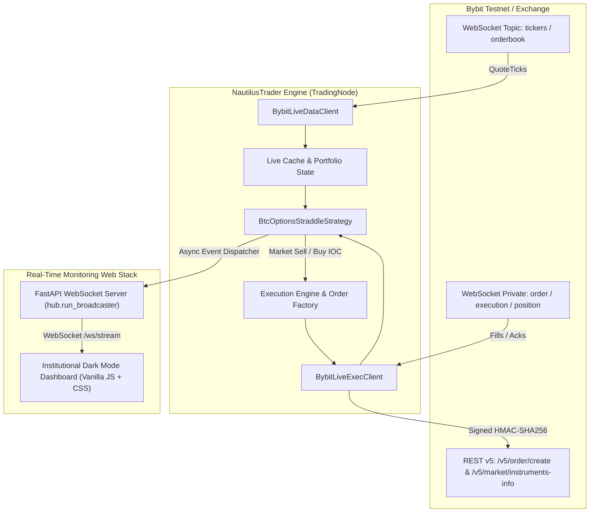

# BTC ATM Short Straddle Trading System (NautilusTrader + Bybit Testnet)

[](https://www.python.org/downloads/)
[](https://nautilustrader.io/)
[](https://fastapi.tiangolo.com/)
[]()

Production-ready, event-driven quantitative options trading system implementing an automated **BTC At-The-Money (ATM) Short Straddle** with institutional-grade risk management (**Level 1: Naked Straddle** + **Level 2: 1% Stop-Loss / 2% Take-Profit**) built on **NautilusTrader** connected to **Bybit Testnet**.

Includes an asynchronous **FastAPI Real-Time WebSocket Monitoring Dashboard** styled in institutional dark mode to visualize active straddle legs, live buyback cost, drift progress towards SL/TP limits, and low-latency OMS audit logs during technical evaluation.

---

## Architecture Overview



---

## Core System Components

### 1. Level 1: Naked Straddle Discovery & Execution
- **Dynamic Instrument Discovery**: Queries `self.cache.instruments()` for active Bybit BTC options.
- **Expiry Selection**: Groups by `expiration_ns` and automatically locks onto the front-active contract maturity.
- **ATM Strike Calculation**: Evaluates the nearest available strike to the live underlying reference price:
  $$\min_{k \in \mathcal{K}} |k - P_{\text{underlying}}|$$
- **Simultaneous Order Routing**: Automatically subscribes to quote feeds, validates Ask quotes on both Call and Put legs, and fires market SELL orders simultaneously with client order tracking.
- **Baseline Cost Basis**: Captures executed fill prices from `OrderFilled` events to establish:
  $$\text{Entry Premium} = P_{\text{call, entry}} + P_{\text{put, entry}}$$

### 2. Level 2: Automated Risk Management (1% SL / 2% TP)
- **Live Buyback Valuation**: Evaluates current ask-side quotes on every incoming `QuoteTick`:
  $$\text{Current Combined Ask} = P_{\text{call, ask}} + P_{\text{put, ask}}$$
- **Drift Percentage**:
  $$\Delta\% = \frac{\text{Current Combined Ask} - \text{Entry Premium}}{\text{Entry Premium}}$$
- **Stop-Loss (+1% Buyback Premium Rise)**: Automatically triggers simultaneous market buyback orders if $\Delta\% \ge +0.0100$.
- **Take-Profit (-2% Buyback Premium Drop)**: Automatically triggers simultaneous market buyback orders if $\Delta\% \le -0.0200$.
- **Idempotency**: Atomic state flags (`is_entering`, `is_entered`, `is_exiting`, `is_closed`) prevent duplicate exit submissions across high-frequency tick bursts.
- **Defensive Exit Filtering**: `_close_positions()` queries `self.cache.position()` and only submits BUY orders for legs with an open `PositionSide.SHORT` and `quantity > 0`, utilizing `TimeInForce.IOC` to prevent unhedged drift.
- **Single-Leg Watchdog**: If one leg fills but the other leg is rejected or stalls for $>10$ seconds, the strategy automatically squares off the filled leg to prevent naked directional delta exposure.

### 3. Real-Time Web Monitoring Dashboard (`web/`)
- Ultra-clean dark theme (`#0a0d14` palette) with zero external CSS framework dependencies.
- Live BTC/USDT spot ticker and front-active ATM strike indicator.
- Live entry combined premium vs. current combined buyback cost.
- Dynamic visual drift indicator: glow transitions to **Rose/Red** when nearing +1% SL, and to **Emerald/Green** when nearing -2% TP.
- Dual progress bars indicating distance to Stop-Loss and Take-Profit in basis points (bps).
- Detailed dual position table displaying Leg, Symbol, Side, Size, Entry Price, Live Ask, and Unrealized PnL.
- Live terminal feed rendering timestamped execution events (`OrderSubmitted`, `OrderAccepted`, `OrderFilled`, `RiskTriggered`).
- Manual emergency flatten button (`POST /api/manual_exit`).

---

## Directory & File Structure

```text
btc-straddle-nautilus/
├── .env.example                     # Environment template with Bybit Testnet parameters
├── requirements.txt                 # Pinned dependencies (NautilusTrader, FastAPI, Pytest)
├── README.md                        # Architectural specification and usage guide
├── WALKTHROUGH.md                   # Complete interview dossier answering all 10 questions
├── config.py                        # StrategyConfig and environment loader
├── strategy.py                      # BtcOptionsStraddleStrategy (Level 1 + Level 2)
├── node.py                          # TradingNode runner and FastAPI background orchestrator
├── web/
│   ├── server.py                    # FastAPI server & WebSocket broadcaster
│   └── static/
│       ├── index.html               # Institutional dark-mode dashboard markup
│       ├── app.js                   # WebSocket streaming client & risk bar renderer
│       └── style.css                # Polished styling and responsive layout
└── tests/
    ├── __init__.py
    ├── test_math_and_triggers.py    # ATM strike, valuation, and exact 1% SL / 2% TP boundary tests
    └── test_order_lifecycle.py      # Idempotency, short-position validation, and watchdog tests
```

---

## Quick Start Guide

### 1. Prerequisites
- Python 3.11 installed.
- (Optional) Bybit Testnet Account API Key and Secret with Options Trading enabled.

### 2. Installation
```powershell
# Clone or navigate to the repository
cd btc-straddle-nautilus

# Install dependencies
pip install -r requirements.txt
```

### 3. Configure Environment
Create `.env` from `.env.example`:
```powershell
cp .env.example .env
```
Edit `.env` with your Bybit Testnet credentials:
```ini
BYBIT_TESTNET_API_KEY=your_bybit_testnet_api_key
BYBIT_TESTNET_API_SECRET=your_bybit_testnet_api_secret
UNDERLYING_SYMBOL=BTCUSDT
TRADE_SIZE=0.01
STOP_LOSS_PCT=0.01
TAKE_PROFIT_PCT=0.02
WEB_PORT=8000
```

---

## Running the Automated Test Suite

Run pytest to verify that all mathematical discovery logic, valuation models, risk boundary triggers, and order lifecycle state transitions pass cleanly:

```powershell
pytest tests/ -v
```

Output:
```text
tests/test_math_and_triggers.py::TestAtmStrikeDiscovery::test_atm_strike_discovery_varying_regimes PASSED
tests/test_math_and_triggers.py::TestAtmStrikeDiscovery::test_empty_strike_list_raises_error PASSED
tests/test_math_and_triggers.py::TestAtmStrikeDiscovery::test_single_strike_list PASSED
tests/test_math_and_triggers.py::TestCombinedPremiumValuation::test_combined_premium_calculation PASSED
tests/test_math_and_triggers.py::TestCombinedPremiumValuation::test_drift_percentage_calculation PASSED
tests/test_math_and_triggers.py::TestCombinedPremiumValuation::test_zero_or_negative_entry_premium_raises PASSED
tests/test_math_and_triggers.py::TestRiskTriggerBoundaries::test_stop_loss_trigger_boundary PASSED
tests/test_math_and_triggers.py::TestRiskTriggerBoundaries::test_take_profit_trigger_boundary PASSED
tests/test_order_lifecycle.py::TestOrderLifecycleAndIdempotency::test_close_positions_only_buys_active_shorts PASSED
tests/test_order_lifecycle.py::TestOrderLifecycleAndIdempotency::test_idempotency_prevents_duplicate_exits PASSED
tests/test_order_lifecycle.py::TestOrderLifecycleAndIdempotency::test_single_leg_failure_watchdog_triggers_square_off PASSED
tests/test_order_lifecycle.py::TestOrderLifecycleAndIdempotency::test_execute_straddle_entry_creates_both_sell_orders PASSED

============================= 12 passed in 1.51s =============================
```

---

## Launching the Live System

### Mode A: Live Bybit Testnet Execution
When `.env` contains active Bybit Testnet API credentials:
```powershell
python node.py
```

### Mode B: Walkthrough Demonstration Mode (Simulation Feeder)
To demonstrate the full strategy lifecycle, live tick drift, SL/TP progress bars, and execution logs immediately without waiting for testnet options market fills:
```powershell
python node.py --simulate
```

Once started, open your browser:
```text
http://localhost:8000
```

---

## Interview Walkthrough Dossier
For detailed technical answers to all 10 architectural questions with exact references to the codebase, refer to [`WALKTHROUGH.md`](file:///c:/Users/HP/Desktop/asse_btc/WALKTHROUGH.md).
