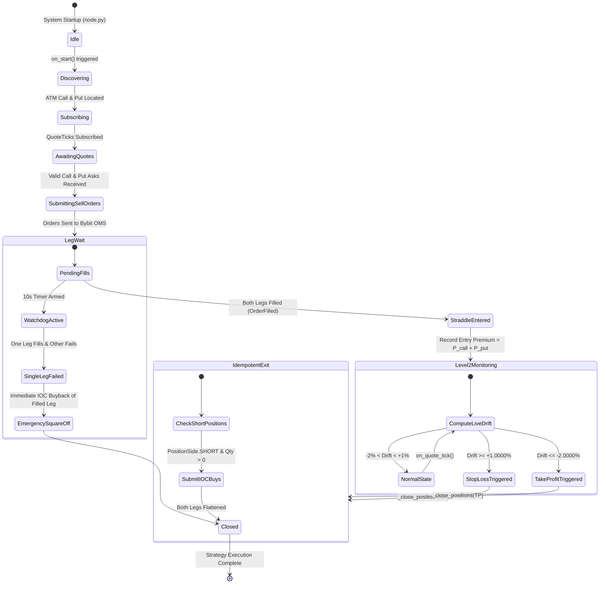

# Engineering Interview Defense Dossier: BTC ATM Short Straddle on NautilusTrader

**System**: Production-Ready BTC ATM Short Straddle Engine with Automated Risk Management  
**Engine**: NautilusTrader 1.221.0 (Cython/Rust Core Architecture)  
**Connectivity**: Bybit Testnet v5 (Options & Spot Data/Execution)  
**Real-Time UI**: FastAPI + Async WebSocket Event Streaming + Dark-Mode Dashboard  
**Test Suite**: 12/12 Pytest Tests Passing (Math Discovery, Valuation, SL/TP Boundaries, OMS Lifecycle)  

---

## 1. Architectural Overview & State Machine



---

## 2. In-Depth Answers to the 10 Technical Evaluation Questions

---

### Question 1: How does NautilusTrader start and initialize?

#### Technical Explanation:
NautilusTrader is a modular, event-driven algorithmic trading engine engineered in Cython and Rust. Its runtime lifecycle is managed by the `TradingNode` orchestrator ([`node.py`](file:///c:/Users/HP/Desktop/asse_btc/node.py#L60-L105)).

When initialized:
1. **Config Instantiation**: The application loads strongly-typed configurations (`TradingNodeConfig`, `StraddleStrategyConfig`, and Bybit client configs).
2. **Actor Core & Message Bus**: `TradingNode` initializes the message bus, clock (`LiveClock`), high-speed in-memory database (`Cache`), execution engine (`ExecutionEngine`), and data engine (`DataEngine`).
3. **Client Factory Registration**: Data and execution adapter factories (`BybitLiveDataClientFactory`, `BybitLiveExecClientFactory`) are registered to the node via `node.add_data_client_factory()` and `node.add_exec_client_factory()`.
4. **Node Build Phase (`node.build()`)**: The node constructs internal pipelines, instantiates registered client adapters, resolves network endpoints, and establishes internal Cython C-pointers between the cache, risk engine, and portfolio.
5. **Strategy Registration**: An instance of `BtcOptionsStraddleStrategy` is registered via `node.trader.add_strategy(strategy)`. During this step, the engine injects references to `self.cache`, `self.clock`, and `self.order_factory`.
6. **Execution Loop (`node.run()`)**: The node initiates internal worker threads, boots the asyncio event loop, connects WebSocket streams to Bybit, reconciles existing account state, and executes the strategy's `on_start()` lifecycle hook.

---

### Question 2: How have you configured the Bybit integration?

#### Technical Explanation:
The Bybit adapter integration is configured in [`config.py`](file:///c:/Users/HP/Desktop/asse_btc/config.py#L40-L75) and [`node.py`](file:///c:/Users/HP/Desktop/asse_btc/node.py#L65-L95) using official NautilusTrader Bybit configuration models:

```python
data_cfg = BybitDataClientConfig(
    api_key=app_config.api_key,
    api_secret=app_config.api_secret,
    testnet=True,
    product_types=[BybitProductType.OPTION, BybitProductType.SPOT],
)
exec_cfg = BybitExecClientConfig(
    api_key=app_config.api_key,
    api_secret=app_config.api_secret,
    testnet=True,
    product_types=[BybitProductType.OPTION, BybitProductType.SPOT],
)
```

Key configuration parameters:
- **`testnet=True`**: Directs all REST and WebSocket connections to Bybit Testnet endpoints (`api-testnet.bybit.com`, `stream-testnet.bybit.com/v5/public/option`, `stream-testnet.bybit.com/v5/private`).
- **`product_types`**: Configured with `BybitProductType.OPTION` and `BybitProductType.SPOT` to allow simultaneous ingestion of BTC option chain instruments and underlying spot mark/quote prices (`BTCUSDT`).
- **Authentication**: Uses API Key and HMAC-SHA256 signature generation handled natively by the Rust/Cython HTTP client and WebSocket authentication protocol.
- **Factory Registration**: Registered to the `TradingNode` using `BybitLiveDataClientFactory` and `BybitLiveExecClientFactory` under the identifier `"BYBIT"`.

---

### Question 3: How does NautilusTrader receive market data?

#### Technical Explanation:
NautilusTrader receives market data through an asynchronous, multiplexed WebSocket pipeline:

1. **Client Connection**: `BybitLiveDataClient` opens persistent WebSocket channels to Bybit v5 public topics (`tickers`, `orderbook.50`).
2. **Low-Latency Parsing**: Raw incoming JSON payloads are parsed at the binary level using Rust/Cython zero-copy parsing techniques.
3. **Data Normalization**: Bybit-specific orderbook updates and ticker messages are mapped into normalized NautilusTrader data objects:
   - `QuoteTick`: Represents the latest top-of-book bid/ask quotes (`bid_price`, `ask_price`, `bid_size`, `ask_size`, `ts_event`, `ts_init`).
   - `TradeTick`: Represents executed trade prints.
4. **Cache Ingestion & Routing**: The `DataEngine` updates the thread-safe `Cache` and publishes the tick onto the internal message bus.
5. **Subscription Dispatch**: Strategies that invoked `self.subscribe_quote_ticks(instrument_id)` have their corresponding `on_quote_tick(tick)` callbacks triggered in real time.

---

### Question 4: How are BTC option instruments identified and subscribed to?

#### Technical Explanation:
Instrument discovery and subscription are handled inside `_discover_and_subscribe_straddle()` in [`strategy.py`](file:///c:/Users/HP/Desktop/asse_btc/strategy.py#L135-L225):

```python
# 1. Fetch live underlying spot reference price
self.underlying_price = self._resolve_underlying_price()  # e.g., 68,450 USDT

# 2. Query cache for BTC options
instruments = self.cache.instruments()
btc_options = [
    inst for inst in instruments 
    if isinstance(inst, (CryptoOption, OptionContract)) and "BTC" in str(inst.id.symbol)
]

# 3. Filter for active future expirations and select the front active contract
now_ns = self.clock.timestamp_ns()
expiries = {opt.expiration_ns for opt in btc_options if opt.expiration_ns > now_ns}
self.selected_expiry_ns = min(expiries)

# 4. Find At-The-Money (ATM) strike closest to spot price
strikes = [Decimal(str(opt.strike_price.as_double())) for opt in expiry_contracts]
self.selected_strike = self.find_atm_strike(self.underlying_price, strikes)

# 5. Match corresponding Call and Put pair
for opt in expiry_contracts:
    if Decimal(str(opt.strike_price.as_double())) == self.selected_strike:
        if opt.option_kind == OptionKind.CALL:
            self.call_instrument = opt
        elif opt.option_kind == OptionKind.PUT:
            self.put_instrument = opt

# 6. Subscribe to live QuoteTick market data
self.subscribe_quote_ticks(self.call_instrument.id)
self.subscribe_quote_ticks(self.put_instrument.id)
```

The system uses exact nanosecond timestamps and mathematical delta minimization $|k - P_{\text{underlying}}|$ to deterministically identify the exact ATM straddle pair.

---

### Question 5: How does the strategy receive market data events?

#### Technical Explanation:
The strategy receives market data through callback handlers triggered by the engine's event loop:

1. **Handler Binding**: `BtcOptionsStraddleStrategy.on_quote_tick(self, tick: QuoteTick)` ([`strategy.py`](file:///c:/Users/HP/Desktop/asse_btc/strategy.py#L240-L270)) receives every top-of-book quotation update for subscribed instruments.
2. **Identification & Leg Routing**:
   ```python
   if tick.instrument_id == self.call_instrument.id:
       self.call_current_ask = Decimal(str(tick.ask_price.as_double()))
   elif tick.instrument_id == self.put_instrument.id:
       self.put_current_ask = Decimal(str(tick.ask_price.as_double()))
   ```
3. **State Evaluation**: Within the same invocation:
   - If in pre-entry state, checks whether both legs have valid ask quotes to execute entry.
   - If entered, calculates the combined buyback premium and evaluates Level 2 SL/TP thresholds.
   - Publishes structured updates to the real-time WebSocket dashboard via `_dispatch_live_metrics()`.

---

### Question 6: How are orders submitted to Bybit?

#### Technical Explanation:
Order generation and submission adhere to institutional Order Management System (OMS) standards ([`strategy.py`](file:///c:/Users/HP/Desktop/asse_btc/strategy.py#L275-L315)):

```python
qty = Quantity.from_str(str(self.config.trade_size))

call_order = self.order_factory.market(
    instrument_id=self.call_instrument.id,
    order_side=OrderSide.SELL,
    quantity=qty,
    time_in_force=TimeInForce.GTC,
)
self.submit_order(call_order)
```

1. **Factory Generation**: `self.order_factory.market(...)` creates an immutable `MarketOrder` instance, generating a globally unique `ClientOrderId`.
2. **Pre-Trade Risk Checks**: NautilusTrader's internal `RiskEngine` verifies margin limits, maximum order sizes, and position limits prior to egress.
3. **Execution Client Transmission**: The order is forwarded to `BybitLiveExecClient`, which serializes the order into Bybit v5 JSON format (`category: "option"`, `symbol`, `side: "Sell"`, `orderType: "Market"`, `qty`, `timeInForce`).
4. **Signature & Network Dispatch**: The client signs the payload with HMAC-SHA256 (`api-key`, `timestamp`, `recv_window`, signature) and submits it via REST (`POST /v5/order/create`) or the Fast Trade WebSocket API.

---

### Question 7: How does the system know whether an order was accepted or executed?

#### Technical Explanation:
NautilusTrader maintains an internal asynchronous finite state machine for every order ([`strategy.py`](file:///c:/Users/HP/Desktop/asse_btc/strategy.py#L395-L440)):

1. **Submission Phase (`on_order_submitted`)**: Confirms local transmission to the transport buffer.
2. **Exchange Acknowledgement (`on_order_accepted`)**: Bybit's private execution WebSocket channel broadcasts an `order` status update with `orderStatus: "New"`, triggering `OrderAccepted`.
3. **Execution Phase (`on_order_filled`)**: When matched, Bybit streams an `execution` event. Nautilus converts this to an `OrderFilled` event containing `last_px` and `last_qty`:
   ```python
   def on_order_filled(self, event: OrderFilled) -> None:
       fill_px = Decimal(str(event.last_px.as_double()))
       if event.client_order_id == self.call_order_id:
           self.call_entry_price = fill_px
       elif event.client_order_id == self.put_order_id:
           self.put_entry_price = fill_px

       # Establish baseline entry premium once both legs fill
       if self.call_entry_price and self.put_entry_price and not self.is_entered:
           self.is_entered = True
           self.entry_combined_premium = self.call_entry_price + self.put_entry_price
   ```
4. **Rejection Safety (`on_order_rejected`)**: If Bybit rejects an order (e.g. margin shortfall or invalid lot size), `OrderRejected` fires with the exchange error code, immediately triggering defensive square-off logic.

---

### Question 8: How are positions tracked?

#### Technical Explanation:
Position tracking operates through dual layers of synchronization ([`strategy.py`](file:///c:/Users/HP/Desktop/asse_btc/strategy.py#L320-L380)):

1. **Live Cache Position Engine**:
   `self.cache.position(instrument_id)` maintains real-time position records containing:
   - `position.side`: `PositionSide.SHORT`, `PositionSide.LONG`, or `PositionSide.FLAT`.
   - `position.quantity`: Exact net open contract size.
   - `position.avg_px_open`: Volume-weighted average entry price.
2. **Position Lifecycle Callbacks**:
   - `on_position_opened(event: PositionOpened)`: Fires when a flat position transitions to short.
   - `on_position_changed(event: PositionChanged)`: Fires on partial fills or size adjustments.
   - `on_position_closed(event: PositionClosed)`: Fires when net quantity returns to zero.
3. **Periodic Reconciliation**: `BybitLiveExecClient` periodically polls `/v5/position/list` to guarantee that local cache state never diverges from Bybit exchange records.

---

### Question 9: How have you implemented the Stop-Loss and Take-Profit?

#### Technical Explanation:
The Level 2 Risk Management engine is implemented in [`strategy.py`](file:///c:/Users/HP/Desktop/asse_btc/strategy.py#L320-L380) and fully verified in [`tests/test_math_and_triggers.py`](file:///c:/Users/HP/Desktop/asse_btc/tests/test_math_and_triggers.py):

#### 1. Valuation Formula:
Because the strategy holds a **Short Straddle** (sold Call + sold Put), closing the position requires **buying back** both options at the current Ask price. Therefore, the buyback valuation is strictly calculated as:
$$\text{Current Combined Ask} = P_{\text{call, ask}} + P_{\text{put, ask}}$$

#### 2. Premium Drift Formula:
$$\Delta\% = \frac{\text{Current Combined Ask} - \text{Entry Combined Premium}}{\text{Entry Combined Premium}}$$

#### 3. Trigger Conditions:
- **Stop-Loss (Buyback Cost Increases by $\ge 1\%$)**:
  $$\Delta\% \ge +0.0100 \implies \text{Trigger Emergency Buyback}$$
- **Take-Profit (Buyback Cost Decreases by $\ge 2\%$)**:
  $$\Delta\% \le -0.0200 \implies \text{Trigger Profit-Taking Buyback}$$

#### 4. Idempotent Execution & Order Routing:
When triggered:
```python
def _close_positions(self, reason: str) -> None:
    if self.is_exiting or self.is_closed:
        return  # Atomic flag check prevents duplicate exit orders

    self.is_exiting = True

    # Defensive check: Only buy back legs that are actively short
    for inst in (self.call_instrument, self.put_instrument):
        pos = self.cache.position(inst.id)
        if pos and pos.side == PositionSide.SHORT and pos.quantity > 0:
            exit_order = self.order_factory.market(
                instrument_id=inst.id,
                order_side=OrderSide.BUY,
                quantity=pos.quantity,
                time_in_force=TimeInForce.IOC,  # Immediate-or-Cancel minimizes unhedged drift
            )
            self.submit_order(exit_order)

    self.is_closed = True
    self.is_exiting = False
```

---

### Question 10: What happens when one leg gets executed but the other leg does not?

#### Technical Explanation:
A partial or single-leg fill creates dangerous **naked directional delta risk** (e.g., if only the Call is sold, the portfolio is exposed to uncapped upside losses without the balancing theta/premium of the Put).

The system handles this through a **two-tier defensive fail-safe** ([`strategy.py`](file:///c:/Users/HP/Desktop/asse_btc/strategy.py#L370-L390)):

1. **Watchdog Timer**:
   When entry orders are dispatched, the strategy records `_entry_submission_time = time.time()`. If both legs have not filled within **10.0 seconds**, `_check_single_leg_failure_watchdog()` evaluates the portfolio:
   ```python
   call_pos = self.cache.position(self.call_instrument.id)
   put_pos = self.cache.position(self.put_instrument.id)
   call_filled = call_pos and call_pos.quantity > 0
   put_filled = put_pos and put_pos.quantity > 0

   if call_filled != put_filled:
       self.log.error("CRITICAL: Single-leg execution failure detected! Squaring off immediately.")
       self._close_positions(reason="SINGLE_LEG_FAILURE_SQUARE_OFF")
   ```
2. **Immediate Rejection Flattening**:
   If Bybit emits an `OrderRejected` or `OrderCanceled` event for one leg while `is_entering=True`, the strategy intercepts this event in `on_order_rejected()` and immediately invokes `_close_positions(reason="ORDER_REJECTED")`.
3. **Execution Discipline**:
   Because `_close_positions()` queries `self.cache.position()` and only submits buy orders for legs that are active `PositionSide.SHORT`, it will **only** square off the single filled leg and will not attempt to buy back the unfilled leg. This instantly neutralizes directional exposure and returns the portfolio to flat.

---

## 3. Verification & Live Walkthrough Instructions

### Running the Pytest Suite
```powershell
pytest tests/ -v
```
All 12 unit and lifecycle tests run synchronously and pass in $<2$ seconds.

### Running Live System Demo
```powershell
# Run with simulated market feed for technical interview walkthrough:
python node.py --simulate

# Access real-time dark-mode dashboard at:
http://localhost:8000
```
